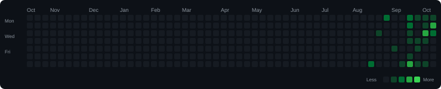

# ⚡ Coding Solutions Portfolio

> Automatically organized, analyzed, and updated by **CodeSyncVault**.

[](docs/AllProblems.md) [](docs/Basic.md) [](docs/Easy.md) [](docs/Medium.md) [](docs/Hard.md) [](https://github.com/vivekkushwahaofficial/CodeSyncVault)

---

## 📑 Table of Contents

- [📚 Solution Documentation](#-solution-documentation)
- [📈 Detailed Statistics](#-detailed-statistics)
- [⚙️ Workflow & Automation](#️-workflow--automation)
- [🗂 Repository](#-repository)

## 📊 Overview

| Metric | Count |
| --- | ---: |
| 🏆 Total Solved | 36 |
| 🔵 Basic | 1 |
| 🟢 Easy | 28 |
| 🟠 Medium | 7 |
| 🔴 Hard | 0 |

## 📈 Progress

| Difficulty | Progress | Solved |
| --- | --- | ---: |
| 🔵 Basic | █░░░░░░░░░░░░░░░░░░░ 3% | 1/36 |
| 🟢 Easy | ████████████████░░░░ 78% | 28/36 |
| 🟠 Medium | ████░░░░░░░░░░░░░░░░ 19% | 7/36 |
| 🔴 Hard | ░░░░░░░░░░░░░░░░░░░░ 0% | 0/36 |

## 🔥 Coding Activity



## 🧩 Pattern Index

| Pattern | Problems |
| --- | ---: |
| [Binary Search](patterns/Binary%20Search.md) | 6 |
| [Hash Map](patterns/Hash%20Map.md) | 6 |
| [Sorting](patterns/Sorting.md) | 5 |
| [Dynamic Programming](patterns/Dynamic%20Programming.md) | 1 |
| [Heap](patterns/Heap.md) | 1 |
| [Monotonic Stack](patterns/Monotonic%20Stack.md) | 1 |
| [Sliding Window](patterns/Sliding%20Window.md) | 1 |
| [Stack](patterns/Stack.md) | 1 |
| [Trie](patterns/Trie.md) | 1 |
| [Two Pointer](patterns/Two%20Pointer.md) | 1 |

## 📚 Topic Index

| Topic | Problems |
| --- | ---: |
| [Array](topics/Array.md) | 8 |
| [Math](topics/Math.md) | 8 |
| [String](topics/String.md) | 4 |
| [Hashing](topics/Hashing.md) | 1 |
| [Linked List](topics/Linked%20List.md) | 1 |

## 💻 Languages

| Language | Problems |
| --- | ---: |
| Java | 31 |
| Python | 4 |
| C++ | 1 |

## 🌐 Platforms

| Platform | Problems |
| --- | ---: |
| LeetCode | 24 |
| GeeksforGeeks | 7 |
| HackerRank | 5 |

## 🕒 Recently Solved

| Problem | Difficulty | Language | Platform | Date |
| --- | --- | --- | --- | --- |
| [First Unique Character in a String](LeetCode/Java/easy/First-Unique-Character-in-a-String/README.md) | Easy | Java | LeetCode | 2026-10-17 |
| [Longest Common Prefix](LeetCode/Java/easy/Longest-Common-Prefix/README.md) | Easy | Java | LeetCode | 2026-10-14 |
| [Fizz Buzz](LeetCode/Java/easy/Fizz-Buzz/README.md) | Easy | Java | LeetCode | 2026-10-13 |
| [Reverse Linked List](LeetCode/Java/easy/Reverse-Linked-List/README.md) | Easy | Java | LeetCode | 2026-10-13 |
| [Nested Lists](HackerRank/Python/Easy/Nested-Lists/README.md) | Easy | Python | HackerRank | 2026-10-12 |
| [Anagram](gfg/Java/Easy/Anagram/README.md) | Easy | Java | GeeksforGeeks | 2026-10-12 |
| [Top K Frequent Elements](LeetCode/Java/medium/Top-K-Frequent-Elements/README.md) | Medium | Java | LeetCode | 2026-10-12 |
| [Maximum Subarray](LeetCode/Java/medium/Maximum-Subarray/README.md) | Medium | Java | LeetCode | 2026-10-11 |
| [Replace Elements with Greatest Element on Right Side](LeetCode/Java/easy/Replace-Elements-with-Greatest-Element-on-Right-Side/README.md) | Easy | Java | LeetCode | 2026-10-10 |
| [Missing And Repeating](gfg/Java/Easy/Missing-And-Repeating/README.md) | Easy | Java | GeeksforGeeks | 2026-10-07 |

## 📚 Solution Documentation

| Resource | Description |
| --- | --- |
| 📚 [All Problems](docs/AllProblems.md) | Complete solution index |
| 🔵 [Basic](docs/Basic.md) | Basic difficulty solutions |
| 🟢 [Easy](docs/Easy.md) | Easy difficulty solutions |
| 🟠 [Medium](docs/Medium.md) | Medium difficulty solutions |
| 🔴 [Hard](docs/Hard.md) | Hard difficulty solutions |
| 🧩 [Patterns](patterns/) | Problems grouped by solving pattern |
| 📚 [Topics](topics/) | Problems grouped by topic |

## 📈 Detailed Statistics

Explore the complete repository analytics including:

- Difficulty distribution
- Platform distribution
- Language usage
- Pattern distribution
- Topic distribution

➡️ **[View Detailed Statistics](stats/progress.md)**

## ⚙️ Workflow & Automation

CodeSyncVault automatically keeps this repository organized:

```text
Accepted Solution
       ↓
Metadata Extraction
       ↓
Pattern & Topic Analysis
       ↓
Solution Packaging
       ↓
GitHub Sync
       ↓
Repository Index Update
       ↓
README & Documentation Regeneration
```

No manual statistics or documentation maintenance is required.

## 🗂 Repository

| Resource | Purpose |
| --- | --- |
| 📚 [.codevault/index.json](.codevault/index.json) | Repository source of truth |
| 🔥 [.codevault/activity.svg](.codevault/activity.svg) | Coding activity heatmap |
| 🧩 [patterns/](patterns/) | Pattern-based indexes |
| 📚 [topics/](topics/) | Topic-based indexes |
| 📖 [docs/](docs/) | Difficulty & problem documentation |
| 📈 [stats/](stats/) | Repository statistics |

---

### 🤖 Powered by CodeSyncVault

This README and the repository documentation are generated automatically from the CodeSyncVault repository index.
